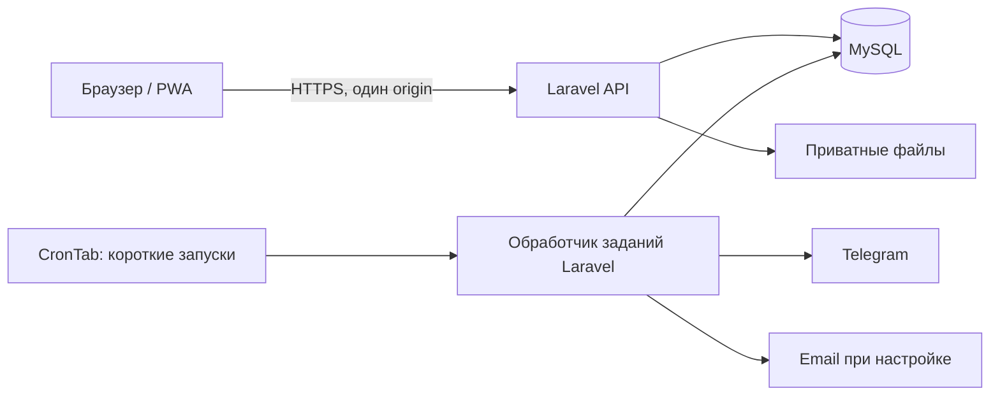

# Асгард — утвержденная архитектура MVP

Версия 1.0 · 22 октября 2026 года  
**Статус: утверждено пользователем 22 октября 2026 года, включая последующие согласованные уточнения.**  
Код приложения, миграции и инфраструктурные конфигурации не создавались.

## Как читать утвержденный документ

Этот документ заменяет предыдущие варианты технического предложения в этом файле. Утверждение фиксирует архитектурный подход, состав компонентов, принципы хранения данных и план итераций. Сейчас отдельно разрешена реализация лендинга; разработка самого приложения требует отдельного поручения.

Бизнес-требования остаются в [FUNCTIONAL_SPEC.md](FUNCTIONAL_SPEC.md), финансовые правила — в [FINANCIAL_RULES.md](FINANCIAL_RULES.md), обязательная приемка — в [ACCEPTANCE_CRITERIA.md](ACCEPTANCE_CRITERIA.md). Этот документ ссылается на них и не заменяет их целиком. [PRODUCT_VISION.md](PRODUCT_VISION.md) задает границы продукта, [AGENTS.md](AGENTS.md) — порядок работы исполнителя. Факты о хостинге и границы проверки — в [BEGET_HOSTING_CHECK.md](BEGET_HOSTING_CHECK.md).

При обнаружении противоречия с решением пользователя не исправлять бизнес-правило техническим предположением: обозначить конфликт до зависимой реализации.

**Ранее согласовано пользователем:**

- React + TypeScript, Laravel + MySQL; существующий Beget рассматривается как площадка MVP.
- Пилот и хранение данных — Россия. Конкретное региональное размещение услуг проверяется до загрузки реальных данных.
- Начисление абонемента — при закрытии ведомости; до закрытия явка черновая.
- Уполномоченный получатель сам подтверждает наличные и сразу уменьшает долг бойца. Передачу на карту подтверждает казначей.
- Исправление закрытой ведомости, влияющее на начисление, ожидает финансового утверждения; прежние явка и начисление остаются действующими, затем меняются вместе.
- Возврат переплаты ограничен текущей положительной переплатой; передача наличных — непереданным остатком. Отдельная банковская отмена может восстановить долг.
- Для начала периода 29–31 в коротком месяце используется последний день; номинальный день следующих месяцев сохраняется.
- Изменяющие действия выполняются только с интернетом.
- Для MVP допустима потеря нескольких дней записей с ручным восстановлением. Базовый вариант — штатные копии Beget, без обязательного почасового копирования и отдельного хранилища. Цель возврата к работе — в течение суток.

Остальные технические решения ниже утверждены **в составе этой версии**. Непроверенные свойства среды не считаются доказанными после утверждения документа.

## A. Архитектурное резюме

«Асгард» — PWA для посещаемости и совместных финансов небольших спортивных секций и клубов исторической реконструкции. Закрытый MVP рассчитан на 1–5 независимых клубов. Основной результат: клуб завершает расчетный период без параллельного Excel.

Продукт учитывает факты, подтвержденные людьми: посещение, получение денег, оплату расхода. Начисление обязательства и движение денег имеют разные основания. Приложение не является платежным посредником.

Для MVP предлагается **модульный монолит**: одно серверное приложение с отдельными внутренними модулями, один API, одна реляционная БД и один интерфейс PWA. Один репозиторий, воспроизводимые зависимости и последовательные небольшие релизы.

Публичной регистрации клубов, коммерческого SaaS-биллинга, универсальной бухгалтерии, произвольных кошельков, нативных приложений и автоматических банковских переводов в MVP нет. Остальные исключения сохраняются по PRODUCT_VISION.md. Будущие бот и мобильные клиенты смогут использовать серверный API; реализовывать их заранее не требуется.

## B. Технологии и размещение

### Целевой стек

- Интерфейс: React, TypeScript, Vite, Tailwind CSS и доступные переиспользуемые компоненты.
- Сервер: Laravel 13, PHP 8.4, Eloquent.
- База: MySQL 8.4, InnoDB, транзакции, внешние ключи и ограничения уникальности.
- PWA: manifest и service worker для оболочки приложения. Финансовые данные и приватные файлы не помещаются в общий кэш.
- Файлы: приватный каталог проекта вне публичного корня, выдача через авторизованный API.
- Уведомления: задания в MySQL, обработка короткими запусками через CronTab.
- Размещение: существующий Beget Blog, HTTPS и один origin для интерфейса/API.
- Проверки: серверные автоматизированные тесты, интеграционные тесты на MySQL 8.4, браузерные проверки основных сценариев и CI без реальных секретов.

Сборка интерфейса и подготовка зависимостей выполняются вне рабочего сайта; на хостинг доставляются подготовленные артефакты. Конкретные версии клиентских пакетов закрепляются при старте реализации после проверки совместимости. Наличие Node.js на production не требуется для обслуживания готовой PWA.

Обязательные Redis, постоянный queue worker, WebSocket-сервер, микросервисы и Kubernetes не вводятся. Разработка может использовать контейнеры для воспроизведения MySQL/PHP, но production на Beget не требует собственного Docker.

### Обоснование выбора

Laravel/MySQL соответствуют уже оплаченному хостингу, поддерживают необходимые транзакционные сценарии и позволяют сопровождать приложение одному разработчику. React/TypeScript сохраняют самостоятельный мобильный интерфейс и общее API для развития.

NestJS/PostgreSQL рассмотрены и не выбраны для MVP: под них пришлось бы отдельно подтверждать размещение и обслуживание. Они не обязательны для надежного финансового учета. План переезда с MySQL на PostgreSQL заранее не закладывается. Серверный рендеринг интерфейса возможен как альтернатива, но отдельный API лучше соответствует будущим клиентам.

### Что проверено на Beget

Просмотр авторизованной панели подтвердил тариф Blog, 3 занятых места под сайты из 5, квоту 12 ГБ с занятыми примерно 0,2 ГБ, включенный SSH, MySQL 8.4.8 и доступные PHP 8.4/8.5. Лимиты нагрузки аккаунта: сайты 80 CP/сутки, MySQL 2500 CP/сутки.

Справочная веб-сборка PHP 8.4.27 содержит необходимые Laravel расширения, включая PDO MySQL; в ней показаны 256 МиБ памяти и 600 секунд выполнения. **Это не лимиты CLI и не измерение будущего сайта.** В аккаунте доступен CronTab; заданий во время проверки не было. Штатные резервные копии существуют.

Причин покупать VPS по просмотренным данным не выявлено. Производительность приложения, PHP CLI, права БД, исходящий доступ к провайдерам, безопасность будущих путей и восстановление еще не испытаны. Число свободных сайтов и объем диска не заменяют такую проверку.

## C. Компоненты, API и фоновые задачи

Схема связей:

Внутренние модули:

1. **Аккаунты и вход:** Telegram/VK, привязка идентичностей, сессии.
2. **Клубы и доступ:** членства, приглашения, полномочия, заморозка, исключение, владение.
3. **Расписание и явка:** разовые/регулярные тренировки, RSVP, назначения, черновики, закрытие, исправления.
4. **Периоды и абонементы:** границы периодов, версии тарифа, интервалы освобождения, обязательства.
5. **Финансовый журнал:** платежи, наличные, передачи, расходы, возвраты, корректировки, сверка.
6. **Уведомления:** внутренние события, очередь доставки, попытки и результаты.
7. **Отчеты и файлы:** Excel, приватные вложения, повторяемый снимок отчета.

Только финансовый модуль проводит события журнала. Другие модули передают ему основание; не меняют остатки напрямую. Интерфейс не рассчитывает авторитетный баланс и не определяет права самостоятельно.

API описывает действия: принять приглашение, ответить на тренировку, сохранить черновик, закрыть ведомость, предложить/утвердить исправление, заявить/подтвердить платеж, принять наличные, подтвердить передачу, оформить возврат, внести сверку, получить отчет. Операции «произвольно перезаписать баланс» нет. Точные маршруты и форматы запросов уточняются внутри этих границ при реализации.

### Уведомления

Факт операции, аудит и задание доставки сохраняются одной транзакцией. После фиксации короткий запуск Laravel обрабатывает готовый пакет. Сетевой вызов Telegram/email не выполняется внутри финансовой транзакции.

У задания есть идентификатор события, получатель, канал, срок следующей попытки, счетчик попыток, аренда выполнения и результат. Уникальность события/получателя/канала предотвращает повторное создание задания. Перекрывающиеся запуски не берут одно задание одновременно.

При сбое доставки финансовая операция остается проведенной. При неопределенном результате сетевой отправки невозможно обещать абсолютное отсутствие повторного сообщения; приложение различает проведенную операцию и состояние ее уведомления. Это не ослабляет защиту финансов от повторов.

Основной канал — Telegram; email резервный при подтвержденном адресе и настроенной доставке. Важные события остаются внутри приложения. Web Push не является единственным каналом.

### PWA и файлы

Без сети нельзя менять запись, подтверждать явку, закрывать ведомость или проводить деньги. Отложенная офлайн-очередь не создается. Интерфейс не показывает успех до ответа сервера; потеря ответа после проведения разрешается безопасным повтором запроса.

Снаружи доступен только публичный каталог. Чеки, секреты, журналы и служебные экспорты находятся вне него. Файловый API проверяет пользователя, клуб, объект и право чтения; случайное знание имени файла не дает доступа. Для загрузки проверяются размер, допустимый тип и безопасный ключ хранения. Публичный симлинк на приватные чеки не создается.

## D. Аккаунты, полномочия и изоляция клубов

Глобальный пользователь отделен от членства в клубе. Один человек может иметь разные клубные имена и полномочия в разных клубах. Клубное имя уникально внутри клуба.

Вход использует отдельные адаптеры Telegram и VK ID. Связь аккаунтов определяется уникальной парой «провайдер + стабильный идентификатор», не совпадением имени или email. Привязка второго провайдера требует действующей сессии и повторной проверки владения идентичностью; уже занятую идентичность нельзя автоматически перенести на другой аккаунт.

Сессии серверные, отзываемые; cookie защищены HttpOnly/Secure, изменяющие запросы защищены от CSRF. Токены провайдеров не сохраняются в localStorage. Для Telegram рассматривается официальный OIDC Authorization Code с PKCE; подписи и назначение токенов проверяются сервером. Вход и разрешение боту писать пользователю — отдельные факты.

Модель доступа — совмещаемые полномочия клуба. Назначение на конкретную тренировку проверяется по самой тренировке. Управляющий или владелец без финансовых полномочий не получает доступ к исправлению денег. Глава с явно назначенными финансовыми правами действует наравне с казначеем. Узкое право подтверждения приема наличных не открывает казну и прочие платежи.

Точные границы чтения финансов, настройки тарифа/автоматизации, финансового календаря и доступа получателя наличных определяет раздел 2 FUNCTIONAL_SPEC.md. Владелец и управляющий без явно назначенных финансовых полномочий не читают общую казну и чужие финансовые данные. Схема разрешений и проверки API должны воспроизводить этот перечень, а не расширять роль по ее названию.

В каждой клубной сущности хранится club_id. Сервер проверяет членство и действие над конкретным объектом; не доверяет clubId из браузера. Составные внешние ключи не позволяют связать платеж клуба A с членством клуба B. Изоляция распространяется на списки, фоновые задания, файлы и экспорт.

MySQL-вариант не рассчитывает на PostgreSQL RLS. Защита обеспечивается серверной авторизацией, обязательным клубным контекстом запросов, ограничениями связей и негативными тестами.

Передача владения и отзыв прав защищаются от конкурентной потери последнего владельца. Штатные полномочия оператора платформы не включают чтение клубных финансов; эксплуатационный доступ к БД ограничивается отдельно.

## E. Финансовая модель

### Источник истины

Предлагается журнал проведенных событий с двумя независимыми видами строк:

- изменение личного баланса участника;
- изменение денег на карте или у ответственного.

Каждый тип события имеет фиксированную допустимую форму строк. Универсальный конструктор проводок пользователю не предоставляется. Сумма личных балансов не обязана равняться деньгам клуба.

Баланс рассчитывается по проведенным строкам, включая отдельные стартовые события. Кэш при необходимости является восстанавливаемым представлением, а не источником истины. Заявки, черновики и ожидаемые расходы не создают проведенных строк.

Суммы хранятся целыми минимальными денежными единицами достаточной разрядности; floating-point не используется. В API денежные целые передаются строками, чтобы исключить потерю точности JavaScript. Валюта задается клубом и проверяется для каждой операции.

У события сохраняются тип, клуб, источник, автор/утвердивший, дата факта, время внесения, причина и связь с исправляемым событием. Штатная роль приложения не изменяет и не удаляет проведенные строки: исправление добавляет новые связанные строки. Администратор БД остается отдельной границей доверия; абсолютная техническая неизменяемость от владельца инфраструктуры не обещается.

### Эффект основных операций

- Начисление 2 500 ₽: личный баланс −2 500 ₽, деньги без изменения.
- Платеж на карту: личный баланс +сумма, карта +сумма.
- Прием наличных: личный баланс +сумма, средства у получателя +сумма.
- Передача на карту: у получателя −сумма, карта +сумма, личный баланс без изменения. Общие деньги сохраняются.
- Неопознанное поступление: карта +сумма, личной строки нет. Идентификация добавляет личную строку без повторного денежного поступления.
- Исправление плательщика: ошибочный личный баланс −сумма, правильный +сумма, деньги без изменения.
- Отмена ошибочного начисления: компенсирующая личная строка; реальные платежи и деньги остаются.
- Возврат переплаты: личный баланс −сумма, соответствующие деньги −сумма; исходный платеж сохраняется.
- Банковская отмена: отменяется исполненная ранее оплата в соответствующей части и уменьшаются фактические деньги; возможно восстановление долга. Неопознанная оплата не порождает личной компенсации до идентификации.
- Оплаченный расход: уменьшаются деньги; личные балансы не меняются.
- Сверка: фиксируется снимок без изменения денег.
- Коррекция неизвестного расхождения: отдельное изменение денежного остатка с причиной, не платеж и не обычный расход.
- Начальные остатки: меняют соответствующий вид остатка и не выглядят доходом/расходом нового периода.

Один платеж может покрыть долг за несколько месяцев; ручное распределение по абонементам не требуется. Переплата уменьшает будущие обязательства. Исторические начисления сохраняются.

### Начисление, календарь и исправление явки

Закрытая тренировка считается состоявшейся: отмена, перенос и изменение ее даты/времени запрещены, включая косвенное изменение через шаблон. Тренировки отменяются заранее, до начала. Исправления явки отдельных участников выполняются отдельно и не меняют факт проведения тренировки.

До закрытия ведомости явка черновая. Закрытие одной транзакцией фиксирует подтвержденную ведомость и проводит необходимые начисления.

Для участника и периода существует одно обязательство с тарифом и историей ревизий. Повторное закрытие либо конкурентное закрытие двух тренировок не создает второй действующий абонемент. При отмене единственной явки обязательство сохраняется, а начисление компенсируется. Если после этого подтверждена другая явка того же периода, новая ревизия восстанавливает положенное начисление без второго независимого обязательства.

Исправление закрытой ведомости, создающее, отменяющее или меняющее начисление, эскалируется казначею и ожидает финансового утверждения, в том числе при добавлении пропущенной первой явки без существующего начисления; действующие явка и начисление не меняются до него. Утверждение применяет их вместе. Перед проведением заново проверяется актуальное состояние периода и остальных явок; устаревшее исправление не проводится по старому расчету.

Основание периода — дата фактической тренировки в зоне клуба, не дата закрытия. До общей активации автоматизации начисления нет. Границы периода сохраняются; интервал включает начало и не включает следующую границу. Для номинального 31-го: 31 января → последний день февраля → 31 марта, без постоянного сдвига на 28-е.

Тарифы и освобождения действуют исторически по периодам. Изменение текущего профиля не пересчитывает прошлые начисления. Смена дня начала/временной зоны уже работающего клуба не должна скрыто менять историю; ее бизнес-порядок уточняется отдельно до реализации такого изменения.

### Транзакционность и повторы

Проведение объединяет смену состояния источника, строки журнала, аудит и задания уведомлений. Успех фиксируется только после commit; ошибка не оставляет частичный результат.

У запроса есть ключ повтора и отпечаток параметров. Тот же ключ с теми же параметрами возвращает прежний результат; несовпадающие параметры отклоняются. Уникальность источника проведения дополнительно не позволяет провести одну заявку дважды даже с новым ключом.

Для небольшого пилота финансовое проведение сериализуется короткой блокировкой служебной строки клуба. Проверки выполняются внутри транзакции, блокировки берутся в общем порядке; дедлоки повторяются ограниченно с тем же бизнес-идентификатором. Сетевые операции не держат блокировку.

Возврат переплаты не превышает текущую положительную переплату; передача — текущий непереданный остаток. Конкурентные операции проверяют лимиты после получения блокировки. Отдельная банковская отмена не блокируется отсутствием переплаты. Уже возвращенную/отмененную часть нельзя списать повторно. Два разных реальных платежа одинаковой суммы/даты допустимы: предупреждение о дубле не равно запрету.

### Даты, сверка и отчетность

Дата факта и время регистрации хранятся отдельно. Отчет различает денежные операции периода, начисления, относящиеся к периоду, и накопленные остатки.

Сверка сравнивает фактическую карту с расчетной картой на один момент, не со всеми деньгами. Сохраняются введенный остаток, расчетный снимок, момент его формирования и расхождение. Поздняя регистрация пропущенной операции не переписывает старую сверку: новый расчет показывает изменения.

Экспорт фиксирует фильтры и время снимка. Он читает ту же подтвержденную историю, что интерфейс; не строит независимый финансовый учет по текущим настройкам. Excel включает данные из FUNCTIONAL_SPEC.md с понятным различением долга, нуля и переплаты.

## F. Предварительная логическая модель данных

Ниже состав сущностей и ключевые ограничения, не готовые SQL/миграции. Для всех клубных сущностей club_id обязателен. Ссылки между клубными записями проверяют принадлежность одному клубу.

### Аккаунты и клубы

- **User:** глобальный ID, состояние, даты.
- **AuthIdentity:** user_id, провайдер, стабильный subject; уникальны провайдер + subject.
- **Session / AuthFlow:** хеш идентификатора сессии, срок/отзыв; одноразовые state/nonce/PKCE и назначение входа или привязки.
- **Club:** имя, валюта/точность, зона, номинальный день периода, дата автоматизации.
- **Membership:** пользователь, клубное имя/нормализованный ключ, статус; уникальны клуб + пользователь и клуб + имя.
- **MembershipStatusHistory:** заморозки, исключения, сроки и авторы.
- **PermissionGrant:** членство, действие, область, срок; владение учитывается явно.
- **Invitation:** клуб, хеш токена, автор, срок/отзыв, факт использования. Конкретная политика приглашений пока не утверждена.

### Тренировки и обязательства

- **WorkoutSeries / Workout:** локальный шаблон; конкретная тренировка, дата/время, статус, версия, исходное вхождение. Уникальность шаблон + вхождение защищает генерацию от дублей.
- **AttendanceAssignment:** ответственное членство и область назначения.
- **RSVP:** тренировка, участник, ответ; одна запись на пару.
- **Attendance:** тренировка, участник, черновая/подтвержденная версия; одна запись на пару.
- **AttendanceRevision / CorrectionRequest:** исходная версия, предложенное изменение, причина, автор, состояние и утверждение.
- **BillingPeriod:** начало/конец, зона и номинальные настройки периода.
- **TariffVersion / ExemptionInterval:** стоимость и первый период; интервалы освобождения с автором/историей.
- **SubscriptionObligation:** членство, период, тариф и ревизия; уникальна пара участник + период. История денег хранится в журнале, а не затирается статусом обязательства.

### Финансы

- **PaymentClaim:** участник, сумма/дата/способ, необязательный файл, статус, связь с фактом поступления.
- **PaymentReceipt / PaymentAttribution:** факт получения и история назначения плательщика; сумма/место/версия и связи с проведенными событиями.
- **MoneyLocation:** карта клуба или уполномоченный получатель; пользовательского конструктора кошельков нет.
- **CashTransfer:** источник, карта, сумма/дата, подтверждение казначея, событие журнала.
- **ExpenseTemplate / ExpenseOccurrence:** шаблон ожидаемого расхода и его вхождение/оплата; уникальны шаблон + вхождение.
- **Refund:** основание, сумма, связь с поступлением при применимости и проведением.
- **FinancialEvent:** клуб, тип, источник, дата факта, время регистрации, автор, причина, связь коррекции.
- **MemberEntry / MoneyEntry:** событие, участник либо место средств, подписанная сумма.
- **Reconciliation / ReconciliationResolution:** введенный/расчетный остаток, момент снимка, расхождение, найденные операции или коррекция.
- **IdempotencyRecord / ClubPostingLock:** ключ, отпечаток и результат запроса; стабильная строка блокировки финансов клуба.

### Доставка, файлы и аудит

- **OutboxMessage:** событие, получатель, канал, срок/аренда/попытки/результат; уникальны событие + получатель + канал.
- **InAppNotification:** событие, пользователь, прочтение.
- **FileAsset:** клуб, приватный ключ, размер/тип, владелец и основание доступа.
- **ExportRun:** фильтры, автор, время снимка, файл.
- **AuditEvent:** автор, действие, объект, время, причина/изменения без секретов.

Основные индексы: членства по пользователю; тренировки по клубу/дате; ведомости по тренировке; обязательства по клубу/участнику/периоду; журнал по источнику и участнику/месту/дате; ожидающие заявки по клубу/статусу/дате; готовые задания по состоянию/следующей попытке.

Финансовые ограничения не заменяются одной проверкой интерфейса. В БД обеспечиваются уникальности, FK, допустимые значения и атомарность; формат строк события проверяется финансовым сервисом в транзакции. Изменяемые документы используют версию для защиты от перезаписи устаревшей формой.

## G. Сквозные пользовательские сценарии

1. **Подключение:** оператор создает клуб → приглашение → вход → членство с нулем → перенос начальных остатков без дохода нового периода → общая дата автоматизации.
2. **Тренировка:** RSVP → черновая явка → закрытие → подтвержденная ведомость и единственный абонемент периода.
3. **Оплата:** заявка или ручной ввод → проверка фактического получения → личный баланс и соответствующее место денег → событие уведомления.
4. **Наличные:** уполномоченный получатель подтверждает → долг уменьшается, деньги у него → казначей подтверждает частичную передачу → карта увеличивается, остаток получателя уменьшается, общие деньги прежние.
5. **Ошибка явки:** ожидающее исправление → финансовое утверждение → явка и компенсация начисления вместе → при прежней оплате возникает переплата, деньги остаются.
6. **Неизвестный перевод:** денежное поступление без участника → идентификация → личная строка без второго поступления.
7. **Сверка:** снимок фактической карты → выявленная разница → содержательное исправление пропущенного факта либо отдельная коррекция с причиной.
8. **Завершение периода:** подтвержденные данные → Excel и остатки → независимая проверка результата без параллельного учета.

## H. Надежность, эксплуатация и ограничения

### Резервное копирование

В MVP используются штатные копии Beget. Пользователь допускает потерю нескольких дней записей; точный максимальный возраст копии не задан. Почасовые копии, собственные получасовые задания и покупка отдельного хранилища не входят в план.

Сохраняется цель восстановления работы в течение 24 часов. Перед пилотом нужен пробный возврат БД и необходимых вложений из согласованной копии, проверка остатков/истории и инструкция повторного ввода пропущенной явки. Платежи восстанавливаются по подтвержденным фактам, а не выводятся из посещений. Оценка явки 20 бойцов не является ограничением размера клуба.

В восстановительной среде реальные сообщения отключаются. При настоящем аварийном восстановлении отправка также остается выключенной до проверки очереди. Копия может содержать задания, отправленные уже после ее создания: статус «ожидает» в восстановленной БД не доказывает, что сообщение не доставлялось. Администратор проверяет доступные сведения о доставке и актуальность событий; подтвержденно отправленные и устаревшие задания исключаются из повторной доставки с сохранением причины. Задания с неизвестным результатом остаются приостановленными до явного решения администратора; автоматическая массовая повторная отправка запрещена. Перед разрешенной отправкой заново проверяются получатель, доступ и актуальность напоминания. Финансовая операция при этом не проводится повторно. Проверка очереди и включение доставки входят в инструкцию восстановления и AC-OPS-02; отсутствие внешнего подтверждения доставки не подменяется обещанием абсолютной защиты от повторных сообщений. Наличие архива не считается успешным восстановлением. Испытание еще не выполнялось.

### Основные риски и меры

- **Ограничения shared-хостинга:** короткие задания, сборка вне production, учет квоты и замер CP. Изменение тарифа рассматривается только при конкретном препятствии.
- **Повторы/конкуренция:** ограничения источников, идемпотентность, транзакции и блокировки; проверки на настоящей MySQL.
- **Изоляция клубов:** серверные права, составные связи, негативные проверки API/файлов/экспорта/заданий.
- **Вход из встроенных браузеров:** ранняя проверка Telegram/VK на Android/iPhone и установленной PWA; безопасный возврат из внешнего браузера.
- **Календарные ошибки:** сохраненные границы периодов, зона клуба, тесты февраля/високосного года/поздней явки.
- **Потеря истории:** запрет штатного изменения проведенных строк, аудит, ограниченный эксплуатационный доступ и восстановление из резервов.
- **Сбой уведомлений:** отдельная обработка и повтор; отказ провайдера не отменяет финансовую операцию.
- **Переполнение диска:** учет чеков/экспортов и ограничение загрузок; сроки хранения временных файлов уточняются до соответствующего модуля.
- **Незавершенные финансовые исключения:** частичная банковская отмена после прежних возвратов требует отдельной проверки переходов; запрещено компенсировать один факт дважды.

В MVP не заявляется высокая доступность при отказе всего аккаунта/провайдера. Допустимая потеря нескольких дней относится к восстановлению после аварии и не разрешает удалять финансовую историю при обычных исправлениях.

## I. План реализации и приемки

После отдельной команды на реализацию приложения:

**Итерация 1 — основа и вход.** Окружение, схема клубов/аккаунтов/прав, Telegram/VK и приглашения. Результат: пользователь безопасно входит и видит только свои клубы. Проверки изоляции, идентичностей и реальных браузеров.

**Итерация 2 — финансовое ядро.** Журнал, начальные остатки, транзакции, защита повторов и конкурентного проведения. Результат: контрольные расчеты воспроизводимы на MySQL, источники не проводятся дважды.

**Итерация 3 — расписание и абонементы.** Членство, шаблоны/разовые тренировки, RSVP, явка, закрытие, периоды, тарифы, освобождения. Результат: первая закрытая явка создает ровно одно положенное начисление. AC-01–06, AC-15–17 и AC-DEC-01/03/04.

**Итерация 4 — платежи.** Заявки, подтверждение, ручной ввод, погашение накопленного долга, неизвестные поступления и исправление плательщика. AC-07/12/14 и связанные AC-F/AC-PAY.

**Итерация 5 — казна.** Наличные/частичная передача, расходы, возвраты, банковские отмены и сверка. AC-10–13, AC-F08–10, AC-DEC-02/06/07.

**Итерация 6 — исправления.** Полный процесс исправления явки, финансовое утверждение, отмена/восстановление обязательства, связанные цепочки возвратов и корректировок. AC-08/09, AC-F14, AC-DEC-05. Базовая защита и журнал уже используются с итерации 2.

**Итерация 7 — завершение пользовательских процессов.** Доставка уведомлений поверх outbox, Excel, PWA, мобильная доступность. AC-18 и AC-REPORT.

**Итерация 8 — пилот.** Полный расчетный период, все критерии, проверки доступа, нагрузка на Beget, восстановление и инструкция администратора. AC-OPS-01.

На каждой итерации проверяются применимые ранние AC-CLUB/USER/EXEMPT/ATT/SUB/PAY/CASH/TREAS/OPEN/REPORT, а не только 18 сценариев Master Prompt. Все AC-F и AC-DEC сохраняются; обязательны также AC-TECH-01–06, AC-AUTH-01–04 и AC-OPS-02. Финансовые тесты проверяют реальные суммы/историю, а не только успешный ответ API.

Отдельно обязательны проверки гонок, повтора после потери ответа, отката транзакции, перерасчета после отмены/восстановления явки и обхода межклубного доступа. Сейчас программных тестов нет и ни один из них не объявляется пройденным.

Каждая итерация заканчивается работающим ограниченным результатом, проверками, обновлением документов и отчетом о сделанном/ограничениях. Сроки в календарных днях не оценены и не обещаются этим документом.

## J. Предмет согласования и оставшиеся проверки

### Утвержденные решения этой версии

1. Модульный монолит, один серверный API и одна MySQL; стек и размещение из раздела B.
2. Совмещаемые клубные полномочия, глобальные аккаунты и изоляцию данных по разделу D.
3. Финансовый журнал с отдельными личными/денежными строками, транзакционным проведением и защитой повторов по разделу E.
4. Предварительную модель сущностей и ограничений по разделу F; точные поля/индексы уточняются при реализации без изменения бизнес-правил.
5. Фоновые пакетные задачи через CronTab и приватное хранение файлов вне публичного каталога.
6. Штатное резервирование Beget с допустимой потерей нескольких дней и проверкой возврата к работе за сутки.
7. Порядок итераций и обязательную приемку по разделу I.

**Новых бизнес-вопросов, блокирующих выбор общей архитектуры, не выявлено.** Есть технические условия перед развертыванием и детали, которые нельзя считать уже согласованными.

### Проверить до развертывания и пилота

- PHP 8.4 в командной строке, нужные расширения, права MySQL/InnoDB и доступные ограничения.
- Условия коротких запусков и исходящий доступ к Telegram/VK/email.
- Домен/HTTPS, настройки приложений провайдеров и безопасность возврата из браузеров. Название домена и реквизиты приложений пока не определены; секреты не запрашиваются в тексте документов.
- Пути/права приватных файлов и отсутствие прямого HTTP-доступа.
- Регион основного размещения/копий перед реальными данными.
- Нагрузка приложения на имеющемся тарифе и пробное восстановление.

Это результаты будущих проверок среды, а не повод снова утверждать выбранный стек. Если найдено конкретное препятствие, сначала описываются его влияние и минимальный вариант устранения.

### Детализировать до зависимых модулей

- Срок/число использований приглашения.
- Точное время предварительных напоминаний и окно предупреждения о дубле платежа.
- Детали частичного банковского возврата, уже возвращенных частей и смены плательщика.
- Изменение даты/зоны периода действующего клуба.
- Сроки хранения временных экспортов и прикладные лимиты загрузок.
- Личная покупка с клубной карты: не считать обычным расходом без согласованной классификации.

Ни одно из этих правил не подставляется скрытым значением по умолчанию как якобы утвержденное пользователем. Уточнение выполняется перед зависимой работой и не расширяет продукт до универсальной бухгалтерии.

### Результат утверждения

Пользователь явно утвердил архитектуру. Актуальная версия — ARCHITECTURE.md; ARCHITECTURE_PROPOSAL.md оставлен только как короткая ссылка на нее. Разрешенный следующий этап — отдельный статический лендинг, без реализации приложения и изменения Beget.

**Сейчас разрешен код отдельного лендинга.** Реализация самого приложения, миграции и изменение Beget требуют отдельного поручения пользователя.

## Основания технического предложения

Публичные механизмы и версии проверялись 22 октября 2026 года, сведения конкретного аккаунта — чтением панели. [Laravel: поддерживаемые версии](https://laravel.com/docs/releases), [требования размещения](https://laravel.com/docs/deployment), [транзакции](https://laravel.com/docs/database); [Beget: CronTab](https://beget.com/ru/kb/manual/crontab), [Laravel на хостинге](https://beget.com/ru/kb/how-to/web-apps/ustanovka-php-frejmvorkov), [резервные копии](https://beget.com/ru/kb/manual/backup); [Telegram Login](https://core.telegram.org/bots/telegram-login), [VK ID SDK](https://github.com/VKCOM/vkid-web-sdk).

Эти источники подтверждают доступность механизмов. Они не являются протоколом тестирования приложения. Технический стек и финансовая архитектура утверждены; проверки работающего приложения и среды еще предстоят.

